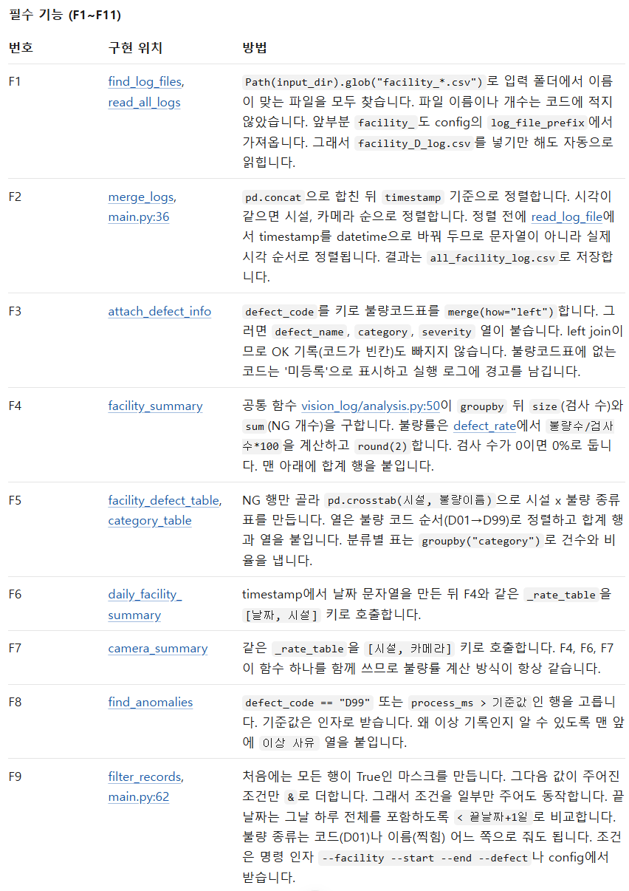
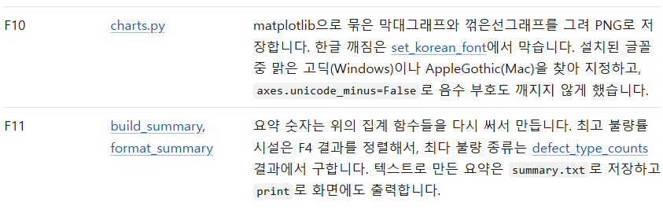
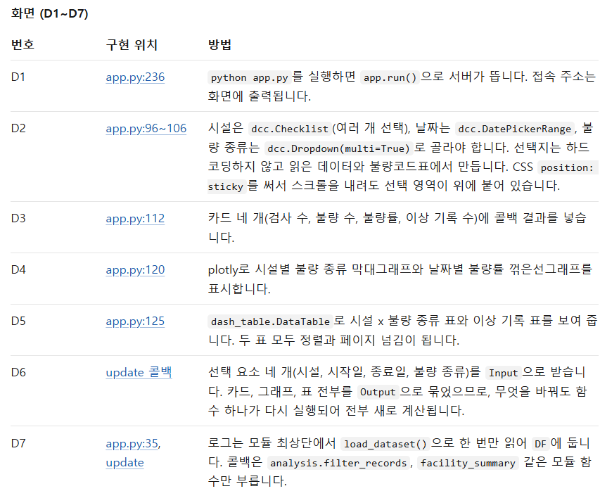
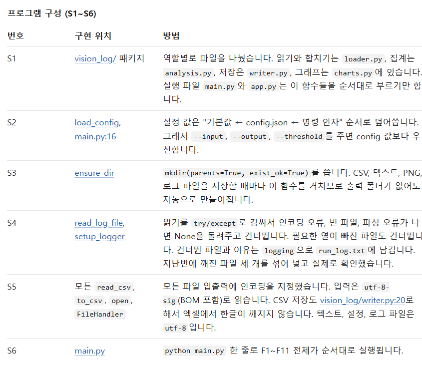

# 비전검사 로그 통합 처리 프로그램

세 시설(A, B, C)의 비전검사 로그를 하나로 합치고, 불량을 종류·시설·날짜·카메라별로 집계해
CSV·PNG·텍스트 파일로 저장하는 프로그램과, 결과를 브라우저에서 보는 Dash 화면입니다.

## 폴더 구성

```
miniproject1/
├─ main.py              # 전체 처리 실행 파일 (명령 한 줄로 실행)
├─ app.py               # Dash 화면 실행 파일
├─ config.json          # 설정 파일 (입력/출력 폴더, 처리 시간 기준값 등)
├─ requirements.txt
├─ vision_log/          # 기능 모듈
│  ├─ config.py         # 설정 파일 + 명령 인자 합치기
│  ├─ loader.py         # 로그 읽기, 합치기, 불량코드 결합, 실행 로그
│  ├─ analysis.py       # 집계, 기록 골라내기, 이상 기록, 요약, 박스 분석(O1), 급증 감지(O2)
│  ├─ charts.py         # PNG 그래프 (한글 글꼴 설정 포함)
│  └─ writer.py         # CSV/텍스트 저장, 출력 폴더 생성
├─ facility_*.csv       # 제공 데이터 (시설 로그)
└─ defect_codes.csv     # 제공 데이터 (불량코드표)
```

## 설치

Python 3.10 이상에서 동작합니다.

```powershell
pip install -r requirements.txt
```

필요한 패키지: pandas, numpy, matplotlib, dash (plotly는 dash와 함께 설치됩니다)

## 실행 방법

### 1) 전체 처리

```powershell
python main.py
```

설정 파일 대신 명령 인자로 바꿀 수도 있습니다.

```powershell
python main.py --input . --output output --threshold 1000
```

조건으로 기록 골라내기(F9). 조건은 일부만 주어도 됩니다. 불량 종류는 코드나 이름 모두 됩니다.

```powershell
python main.py --facility A시설 C시설 --start 2026-11-17 --end 2026-11-18 --defect D01 찍힘
```

### 2) Dash 화면

```powershell
python app.py
```

실행 후 브라우저에서 http://127.0.0.1:8050 을 엽니다. 시설(여러 개), 날짜 범위, 불량 종류를 고르면
요약 숫자·그래프·표가 모두 다시 계산됩니다.

- 불량 종류를 고르면 검사 수는 그대로 두고, 고른 불량 종류만 불량으로 세어 불량률을 계산합니다.
- 이상 기록 목록은 시설·날짜 조건만 적용합니다(처리 지연 기록은 불량이 아닐 수도 있으므로).

## 설정 항목 (config.json)

| 항목 | 기본값 | 설명 | 명령 인자 |
|---|---|---|---|
| input_dir | `.` | 시설 로그와 불량코드표가 있는 폴더 | `--input` |
| output_dir | `output` | 결과 저장 폴더 (없으면 자동 생성) | `--output` |
| log_file_prefix | `facility_` | 시설 로그 파일 이름 앞부분 | |
| defect_code_file | `defect_codes.csv` | 불량코드표 파일 이름 | |
| process_ms_threshold | `1000` | 이상 기록으로 볼 처리 시간 기준(ms) | `--threshold` |
| run_log_file | `run_log.txt` | 실행 로그 파일 이름 | |
| filter.facilities / start_date / end_date / defect_codes | `null` | F9 기본 조건 | `--facility --start --end --defect` |
| spike.min_defects / rate_ratio / z_score | `5 / 2.0 / 3.0` | 불량 급증 판단 기준 (O2) | |
| dash.host / port | `127.0.0.1 / 8050` | Dash 주소 | `app.py --port` |

다른 설정 파일을 쓰려면 `--config 경로`를 줍니다.

## 출력 파일 (output 폴더)

모든 CSV는 UTF-8 BOM으로 저장해 엑셀에서 한글이 깨지지 않습니다.

| 파일 | 내용 | 요구사항 |
|---|---|---|
| all_facility_log.csv | 전체 시설 로그 (검사 시각 순 정렬, 불량 이름·분류·심각도 추가) | F2, F3 |
| summary_by_facility.csv | 시설별 검사 수, 불량 수, 불량률(%) + 합계 | F4 |
| defects_by_facility_type.csv | 시설 x 불량 종류 불량 건수 (합계 행·열 포함) | F5 |
| defects_by_category.csv | 불량 분류별 건수와 비율 | F5 |
| summary_by_date_facility.csv | 날짜별·시설별 검사 수, 불량 수, 불량률 | F6 |
| summary_by_camera.csv | 카메라별 검사 수, 불량 수, 불량률 | F7 |
| anomaly_records.csv | 판정 불가(D99) 또는 처리 시간 기준 초과 기록, `이상 사유` 열 포함 | F8 |
| filtered_records.csv | 조건으로 골라낸 기록 (조건을 준 경우에만) | F9 |
| chart_facility_defects.png | 시설별 불량 종류 건수 막대그래프 | F10 |
| chart_daily_defect_rate.png | 날짜별 시설 불량률 추이 꺾은선그래프 | F10 |
| summary.txt | 전체 요약 (화면에도 출력) | F11 |
| box_stats_by_defect.csv | 불량 종류별 박스 평균 크기·중심점·주요 위치 | O1 |
| box_region_by_defect.csv | 불량 종류 x 사진 3x3 구역 건수 | O1 |
| defect_spikes.csv | 불량 급증 감지 결과 | O2 |
| run_log.txt | 실행 로그 (읽은 파일, 건너뛴 파일과 이유, 저장한 파일) | S4 |
| dash_run_log.txt | Dash 화면 시작 시 로그 | S4 |

## 계산 기준

- **불량**: `result`가 `NG`인 기록. 판정 불가(D99)도 NG이므로 불량에 포함됩니다.
- **불량률(%)**: 불량 수 / 검사 수 x 100, 소수 둘째 자리 반올림.
- **건너뛰는 파일**: 읽을 수 없는 파일(인코딩 오류, 빈 파일 등)이나 필요한 열이 없는 파일은
  건너뛰고 `run_log.txt`에 파일 이름과 이유를 남깁니다.

### O1. 불량 박스 분석

박스 좌표로 너비, 높이, 면적, 중심점((x1+x2)/2, (y1+y2)/2)을 계산합니다. 사진(1280x1024)을
가로·세로 3등분한 9개 구역(상-좌 ~ 하-우) 중 중심점이 속한 구역을 위치로 봅니다.

### O2. 불량 급증 감지 기준

날짜·시설·카메라 단위로, 아래 세 조건을 **모두** 만족하면 "평소보다 크게 늘었다"고 판단합니다.

1. 그날 그 카메라의 불량 수가 5건 이상 — 건수가 너무 적으면 우연한 변동일 수 있으므로 제외
2. 그날 불량률이 평소 불량률의 2배 이상 — 평소 불량률은 **같은 카메라의 그날을 뺀 나머지 날** 전체
   불량 수 / 검사 수 (그날 자체가 기준에 섞이지 않도록 제외)
3. z = (그날 불량률 − 평소 불량률) / √(평소 불량률 × (1 − 평소 불량률) / 그날 검사 수) ≥ 3 —
   이항분포로 봤을 때 우연이라고 보기 어려운 차이

기준값은 `config.json`의 `spike` 항목에서 바꿀 수 있습니다.

## 기능 여부







# bootcamp_projcet1
